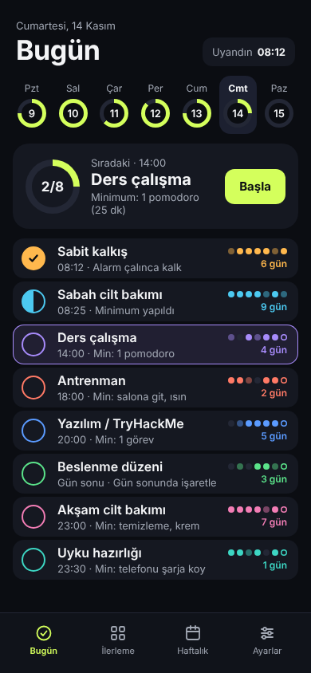

# Routine

A local-first routine tracker PWA built to make starting easy.

- Visual streaks and heatmaps for daily routines
- "Minimum version" check-offs so a bad day still counts
- Focus sessions and a night wind-down mode (planned)
- Reminders exported to the iPhone Calendar (planned)
- All data stays on the device: no account, no server

**Stack:** React, TypeScript, Vite, Tailwind, Dexie (IndexedDB).

## Develop

    npm install
    npm run dev
    npm test

See `docs/ARCHITECTURE.md` and `docs/DESIGN.md`.
